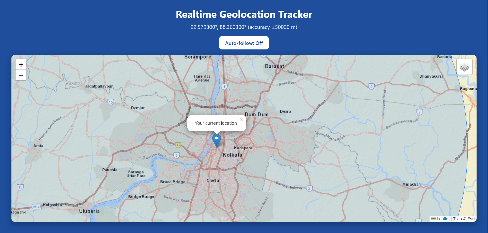

# Realtime Geolocation Tracker

A lightweight, dependency-free web app that tracks your position in real time and plots it on an interactive map, built with the browser Geolocation API and Leaflet.

**[Live demo](https://rajkdas.github.io/live-gps-tracking-leaflet/)**



## Features

- **Live position tracking** using `navigator.geolocation.watchPosition`, with the marker updating as the device moves
- **Accuracy radius** drawn around the marker, with the reported accuracy shown in metres
- **Smart auto-follow** that keeps the map centred on you, pauses when you drag the map, and re-centres with one click
- **Multiple basemaps** (street, satellite, OpenStreetMap) with a built-in layer switcher
- **Resilient startup**: a fast network-based first fix, then an automatic upgrade to high accuracy (GPS on supported devices), with fallback if it stalls
- **Clear status and error messages** for permission prompts, denied access, timeouts, and unavailable location
- **Responsive** layout for desktop and mobile
- **Accessible**: live status announcements, keyboard-focusable controls, and reduced-motion support
- **Pinned dependencies**: Leaflet is loaded at a fixed version with Subresource Integrity checks
- **Single static file**: no build step, no backend, no API keys

## Tech Stack

| Area | Technology |
| --- | --- |
| Language | HTML5, CSS3, vanilla JavaScript (no framework, no build step) |
| Mapping | [Leaflet](https://leafletjs.com/) 1.9.4 |
| Location | Browser Geolocation API |
| Basemaps | Esri World Street Map, Esri World Imagery, OpenStreetMap |
| Hosting | GitHub Pages |

## How It Works

1. On load, the app checks the Geolocation permission state through the Permissions API.
2. If permission is already granted it starts immediately; otherwise it shows an **Enable location** button so the browser prompt follows a user action.
3. A fast, network-based position is requested first so the marker appears quickly.
4. After the first fix, the app switches to a high-accuracy watch (GPS where the device has it). If that stalls, it falls back to the fast mode.
5. Each position update moves the marker and accuracy circle, and pans the map while auto-follow is on.

## Accuracy

Accuracy depends on the device and its sensors:

| Device | Typical accuracy | Source |
| --- | --- | --- |
| Smartphone (outdoors) | 5 to 20 m | GPS |
| Laptop with Wi-Fi | tens to hundreds of metres | Wi-Fi positioning |
| Desktop on wired network | kilometres | IP-based estimate |

Desktop computers usually have no GPS hardware, so for the best demo open the live link on a phone.

## Run Locally

The Geolocation API requires a secure context (HTTPS or `localhost`), so serve the file instead of opening it directly.

```bash
git clone https://github.com/rajkdas/live-gps-tracking-leaflet.git
cd live-gps-tracking-leaflet

# Python
python -m http.server 8000

# or Node
npx serve .
```

Then open `http://localhost:8000`.

## Project Structure

```
live-gps-tracking-leaflet/
├── index.html        # App markup, styles and logic
├── docs/
│   └── screenshot.png
├── LICENSE
└── README.md
```

## Browser Support

Works in current versions of Chrome, Edge, Firefox, and Safari, on desktop and mobile. Location permission must be granted for the page.

## Privacy

Your coordinates are processed entirely in your browser. Nothing is stored or sent to any server by this app. Map tiles are requested from the tile providers, which see standard tile requests (including the map area you view) as with any web map.

## Attribution

- Map library: [Leaflet](https://leafletjs.com/)
- Map data: &copy; [OpenStreetMap](https://www.openstreetmap.org/copyright) contributors
- Tiles: &copy; Esri

## License

Released under the [MIT License](LICENSE).

## Author

**Raj K. Das** — Senior Software Engineer

- Portfolio: [rajkdas.github.io](https://rajkdas.github.io/)
- LinkedIn: [full-stack-developer-agentic-ai](https://www.linkedin.com/in/full-stack-developer-agentic-ai/)
- GitHub: [@rajkdas](https://github.com/rajkdas)
